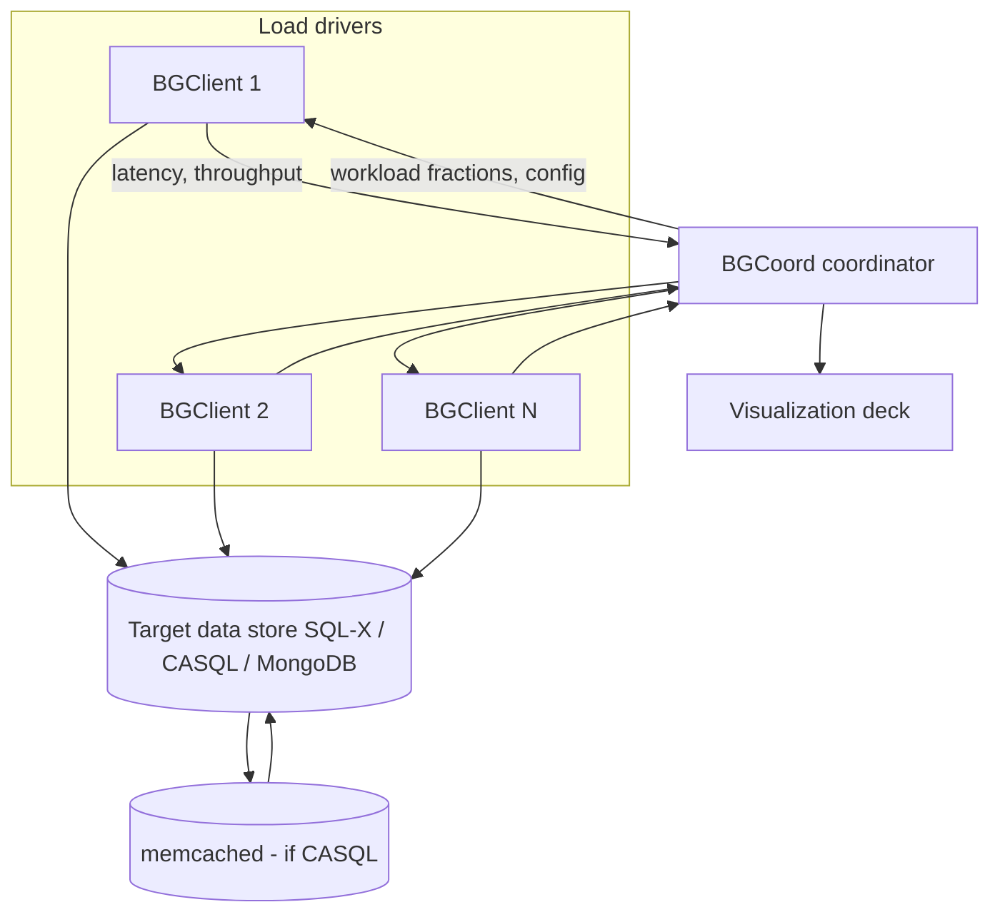

# BG: A Benchmark to Evaluate Interactive Social Networking Actions

**Full citation:** Sumita Barahmand and Shahram Ghandeharizadeh. *BG: A Benchmark to Evaluate Interactive Social Networking Actions.* CIDR 2013 (Asilomar, CA). USC Database Lab.  
**Project site:** [bgbenchmark.org](http://bgbenchmark.org)

This guide is written for **CS 585** exam prep: motivation, definitions, architecture, data model, workloads, metrics, experiments, and likely exam questions—tied together so each section follows from the last.

**Also in this folder:**

- **[BG_Paper_Full_Primer.md](BG_Paper_Full_Primer.md)** — **start here** if you want every concept explained from scratch (Q&A, examples, CAP/partitions/caches, full paper walkthrough)
- [BG_Paper_Flashcards.md](BG_Paper_Flashcards.md) — Q/A tables by deck
- [BG_Paper_Lecture_Slides.md](BG_Paper_Lecture_Slides.md) — 45 short slides + 45-min outline
- [BG_Paper_Exam_QA.md](BG_Paper_Exam_QA.md) — example exam/oral questions with model answers

---

## Table of contents

1. [Why this paper exists (the story)](#1-why-this-paper-exists-the-story)
2. [Glossary: terms you must know cold](#2-glossary-terms-you-must-know-cold)
3. [Problem statement and contributions](#3-problem-statement-and-contributions)
4. [How BG differs from other benchmarks](#4-how-bg-differs-from-other-benchmarks)
5. [BG architecture](#5-bg-architecture)
6. [Conceptual data model](#6-conceptual-data-model)
7. [Physical representations (SQL-X, CASQL, MongoDB)](#7-physical-representations-sql-x-casql-mongodb)
8. [The eleven social actions](#8-the-eleven-social-actions)
9. [Workload generation and action mixes](#9-workload-generation-and-action-mixes)
10. [Performance metrics and SLA](#10-performance-metrics-and-sla)
11. [SoAR and Socialites (how ratings are computed)](#11-soar-and-socialites-how-ratings-are-computed)
12. [Unpredictable data (first-class metric)](#12-unpredictable-data-first-class-metric)
13. [Caching: invalidation vs TTL](#13-caching-invalidation-vs-ttl)
14. [Parallelism and scale-out](#14-parallelism-and-scale-out)
15. [Experimental setup and key results](#15-experimental-setup-and-key-results)
16. [Related work](#16-related-work)
17. [Limitations and future work](#17-limitations-and-future-work)
18. [Exam cheat sheet](#18-exam-cheat-sheet)
19. [Practice questions with answers](#19-practice-questions-with-answers)

---

## 1. Why this paper exists (the story)

### 1.1 What industry was building

Sites like Facebook, Twitter, LinkedIn, and Google+ are **cloud services for person-to-person communication**. Under the hood they are **data stores** plus application logic. Teams choose among:

- **Relational DBMS (SQL)** — tables, joins, ACID transactions.
- **Document stores (NoSQL)** — e.g. MongoDB, JSON-like documents, often scale-out.
- **Caches** — e.g. **memcached**, a fast in-memory key-value store in front of the database.
- **Cache-augmented SQL (CASQL)** — SQL database + memcached with explicit cache management.
- **Graph-oriented designs** — social graph as first-class structure (BG is not graph-only; it benchmarks *actions*, not a specific graph engine).

Architectures also differ on **CAP**: under network partitions, systems lean **CP** (consistency over availability) or **AP** (availability over eventual consistency).

### 1.2 What was missing

Classic benchmarks did not match **interactive social networking**:

| Benchmark | What it measures | Why it is a poor fit for social SNAs |
|-----------|------------------|--------------------------------------|
| **TPC-C / TPC-E** | OLTP (orders, warehouses) | Schema and access patterns are not friend lists, walls, thumbnails |
| **YCSB** | Generic key-value/cloud serving | No social *actions*, no friend graph semantics, no “unpredictable read” SLA |
| **OO7** | Object-oriented DB | Old object model, not modern SN workloads |

Researchers and vendors could claim “we are fast” using the wrong yardstick. BG’s goal is a **domain-specific, SLA-driven** yardstick for **social networking actions (SNAs)**.

### 1.3 What “interactive social networking” means in BG

- **Interactive:** a human (or simulated user) waits for a response; latency matters.
- **Actions:** small, well-defined operations (view profile, list friends, accept request, post on wall, …).
- **Small touch of big data:** each action reads or writes a **tiny fraction** of a **huge** social graph (millions of members), like real SN sites.

That last point is crucial: BG is **not** a bulk analytics benchmark. It is **many concurrent small reads/writes** on a large dataset.

---

## 2. Glossary: terms you must know cold

| Term | Meaning in BG |
|------|----------------|
| **SNA (Social Networking Action)** | One logical user operation the benchmark issues (e.g. View Profile). |
| **Socialite** | A simulated user in the workload; often **one thread ≈ one socialite**. |
| **SLA (Service Level Agreement)** | Contract for the run: latency percentile **and** cap on **unpredictable data**, over a **duration**. |
| **SoAR (Social Action Rating)** | **Maximum throughput** (actions/sec) while the SLA is met. |
| **Socialites** | **Maximum number of concurrent threads** (concurrent socialites) while the SLA is met. |
| **Throughput** | Completed actions per second. |
| **Response time / latency** | Time from issuing an action until the result is returned to the client. |
| **Unpredictable data** | Data returned to the client that is **stale, invalid, or inconsistent** with the true state of the database (see §12). |
| **Freshness confidence** | Characterizes how well a **weak consistency** technique (e.g. TTL) keeps cache fresh. |
| **SQL-X** | BG’s label for an **industrial-strength RDBMS** implementation of the schema/actions (baseline, no memcached). |
| **CASQL** | **Cache-Augmented SQL**: same RDBMS + **memcached**; cache keys/values maintained by the implementation. |
| **BGClient** | Worker process that generates load (issues SNAs). |
| **BGCoord** | Coordinator: splits workload, monitors clients, aggregates metrics, drives visualization. |
| **Logical partition / fragment** | Shard of the social graph assigned so parallel workers mostly avoid conflicting on the same data. |
| **Closed workload model** | Each thread issues **one request at a time**; next request starts only after the previous completes (like a user waiting). |
| **D-Zipfian** | Skewed access distribution (related USC work); popular members get more visits—realistic hot spots. |
| **Invalidation** | On write, **delete or update** affected cache entries so later reads refetch from DB. |
| **TTL (time-to-live)** | Cache entries expire after N seconds; **no** immediate invalidation on write—simpler but staler. |
| **Gumball** | USC technique to prevent cache **race conditions** (cited as way to drive unpredictable data toward zero). |

**ACID vs BASE (context only):**  
- **ACID:** strong transactional guarantees.  
- **BASE:** basically available, soft state, eventual consistency—often used when sacrificing strict consistency for scale/latency. BG can compare behavior under failures (**CP vs AP**), not just happy-path throughput.

---

## 3. Problem statement and contributions

### 3.1 Research question

> How do we **quantitatively compare** data stores and designs for **interactive** social networking, including caches and consistency tradeoffs?

### 3.2 BG’s design decisions (memorize as a list)

1. **SLA-based ratings:** **SoAR** (throughput) and **Socialites** (concurrency), not a single average latency number.
2. **Unpredictable data as first-class:** part of the SLA, measured during the run (not an afterthought).
3. **Workload realism:** read/write **small amounts** from **large** graphs; action mix configurable.
4. **Modular & store-agnostic:** implement the same logical actions on SQL-X, CASQL, MongoDB, etc.
5. **Scale:** **logical partitioning** so benchmarks can run on **many nodes** (shared-nothing style).
6. **Visualization:** monitor runs and find bottlenecks in real time.

### 3.3 What the CIDR paper demonstrates

Primary case study: compare **MongoDB** vs **SQL-X** vs **CASQL** (RDBMS + memcached) on BG actions and mixes.  
**Main headline:** *No system wins every action*; for **mixed** workloads, **CASQL** often achieves **higher SoAR** than SQL-X alone or MongoDB alone—but **cache design, object size, and consistency mechanism** dominate.

---

## 4. How BG differs from other benchmarks

| Dimension | YCSB / generic cloud | BG |
|-----------|----------------------|-----|
| Domain | Generic keys | **Social actions** (friends, wall, profile) |
| Metric focus | Throughput, latency percentiles | Same **plus unpredictable reads in SLA** |
| Schema | Simple tables | **Members, Friends, Resources, Manipulation** |
| Cache consistency | Often ignored | **Central** (invalidation vs TTL, freshness) |
| Concurrency model | Often open-loop | **Closed** (user-like) by default for Socialites |

**LinkBench** (Facebook, later) is another social benchmark; BG (USC, CIDR 2013) is earlier and emphasizes **SLA + unpredictable data + CASQL**.

---

## 5. BG architecture

High-level components:



**BGCoord responsibilities:**

- Reads experiment parameters (SLA, duration, mix, scale).
- Computes what **fraction of workload** each **BGClient** runs.
- Periodically **aggregates** response times and throughput.
- After clients finish, produces final **SoAR / Socialites** and unpredictability stats.

**BGClient responsibilities:**

- Acts as many **socialites** (threads).
- Issues SNAs according to the mix and access distribution.
- Records timing for SLA evaluation.

**Validation phase:** separate logic (can be centralized) compares responses against **ground truth** from write/read logs to detect **unpredictable** reads (§12).

---

## 6. Conceptual data model

BG uses a **relational conceptual schema** (logical model). Physical layout differs per system (§7).

### 6.1 Entity: `Members`

Represents a user account.

Typical attributes (as in the paper’s figures):

- `userid` — primary identifier  
- `username`, `pw` (password)  
- `firstname`, `lastname`, `gender`  
- `dob` (date of birth)  
- `jdate`, `ldate` (join / last login dates)  
- `address`, `email`  
- `profileImage`, `thumbnail` — **binary/large object** fields; **image size is a major experimental knob**

### 6.2 Entity: `Friends`

Undirected friendship **requests and confirmations** as edges.

- `userid1`, `userid2`  
- `status` — e.g. **pending** vs **confirmed**

### 6.3 Entity: `Resources`

Content on a member’s wall (posts).

- `rid` — resource id  
- `creatorid` — who created it  
- `wallUserid` — whose wall it appears on  
- `body`, `doc` — text / document payload  

### 6.4 Entity: `Manipulation`

**Audit / version** information for resources (who changed what, when).

- `mid`, `modifierid`, `rid`, `resourcecreatorid`  
- `timestamp`, `type`, `content`  

**Why Manipulation exists:** supports actions that **modify** wall content and helps **validate** correctness and freshness of reads.

### 6.5 Conceptual picture

```text
Members ----< Friends >---- Members     (graph edges, status)
Members ----< Resources                   (wall posts)
Resources ----< Manipulation              (history of changes)
```

---

## 7. Physical representations (SQL-X, CASQL, MongoDB)

Same **logical** actions, **different** storage patterns.

### 7.1 SQL-X (relational only)

- Normalized tables: `Members`, `Friends`, `Resources`, `Manipulation`.
- Actions implemented as **SQL queries/updates** (joins for List Friends, etc.).
- **ACID** transactions where needed (e.g. accept friend updates one row’s `status`).

### 7.2 MongoDB (document store)

Example pattern from the paper/slides:

- **One document per member** with embedded arrays, e.g. `Friends: []`, `confirmedFriends`, `pendingFriends`.
- **Accept Friend Request (AFR):** update **two** member documents—add ids to confirmed arrays, remove from pending on the appropriate side.
- Reads like **View Profile** may be **one document read**; **List Friends** may require **multiple document reads** (e.g. one per friend) depending on implementation—this affects SoAR.

### 7.3 CASQL (SQL + memcached)

- Authoritative data still in **SQL-X**.
- **Hot keys** cached in **memcached** (profiles, friend lists, etc.).
- On writes, implementation must **invalidate** or rely on **TTL** (§13).
- **Memcached limit:** classic deployment caps **value size** (paper discusses **1 MB** default; large aggregated values break caching).

**Exam trap:** CASQL can show **SoAR = 0** or memcached **idle** if each cache value exceeds memcached’s max size—then every read goes to SQL-X and may **miss SLA** anyway.

---

## 8. The eleven social actions

BG defines **11 SNAs** that cover profile reads, friend-graph mutations, and wall activity. Names below match the benchmark documentation and dissertation; exam questions often focus on **VP**, **LF**, and **AFR** because the paper walks through them in detail.

| # | Action (typical acronym) | Type | What it does (logical) |
|---|--------------------------|------|-------------------------|
| 1 | **View Profile (VP)** | Read | Fetch a member’s profile (including thumbnail). |
| 2 | **List Friends (LF)** | Read | List confirmed friends; for each friend, fetch **basic info + thumbnail** (N+1 style access). |
| 3 | **Send Friend Request (SFR)** | Write | Create pending edge A→B. |
| 4 | **Accept Friend Request (AFR)** | Write | Confirm friendship; clear pending state. |
| 5 | **Reject Friend Request (RFR)** | Write | Decline pending request. |
| 6 | **Unfriend (UF)** | Write | Remove confirmed friendship. |
| 7 | **List Pending Friend Requests (LPFR)** | Read | Show pending invitations. |
| 8 | **Write Resource (WR)** | Write | Post on a wall (new Resource). |
| 9 | **Read Resource / View Wall (RR)** | Read | Read wall content. |
| 10 | **Comment on Resource (CR)** | Write | Add comment / manipulation. |
| 11 | **Share Resource (SR)** | Write | Share / propagate resource (as defined in BG spec). |

### 8.1 Deep dive: View Profile (VP)

- **Access pattern:** read **one member**’s attributes + **thumbnail**.
- **Sensitive to:** thumbnail size (2 KB vs 12 KB vs 500 KB in experiments).
- **MongoDB:** often single document read.
- **SQL-X:** row fetch + LOB for image.
- **CASQL:** cache key for profile; write actions on profile must invalidate or wait for TTL.

### 8.2 Deep dive: List Friends (LF)

- **Access pattern:** read friend ids, then for **each** friend read profile snippet + thumbnail → **amplifies** bytes moved and round trips.
- **Why it hurts SQL-X at large images:** moving hundreds of thumbnails in one SLA window is hard.
- **Why it hurts CASQL:** caching **entire friend list + all thumbnails** as one value can exceed **memcached 1 MB** limit → cache useless → falls back to SQL → poor SoAR.
- **MongoDB tradeoff:** may fetch friends **one document at a time** vs denormalized bundles—latency vs size tradeoffs.

### 8.3 Deep dive: Accept Friend Request (AFR)

- **SQL-X / CASQL:** `UPDATE Friends SET status='confirmed'` for the pair; **CASQL** also **invalidates** keys for: both users’ profiles, friend lists, pending lists, “profile as viewed by others,” etc.
- **MongoDB:** multi-document updates to embed friend ids in arrays on **both** members.
- **Consistency story:** if cache invalidation is wrong or racy, subsequent **VP/LF** can return **unpredictable** data.

---

## 9. Workload generation and action mixes

### 9.1 Parameters (conceptual “Table 2” in paper)

Experiments are configured with knobs such as:

- Number of **members** in the database (scale).  
- **Number of BGClients** and **threads** per client.  
- **Action mix** (% read vs write; which SNAs).  
- **Thumbnail / image sizes**.  
- **SLA:** percentile latency threshold (e.g. **95% < 100 ms**), max **% unpredictable** (e.g. **0.01%** or **0.001%**), **duration** (e.g. **10 minutes**).  
- **Cache policy:** invalidation vs **TTL** (30, 60, 120 seconds in TTL experiments).  
- **Write percentage** in mixed workload (e.g. **0.1%, 1%, 10%** writes).

### 9.2 Three mixes (Table 3 in paper)

The paper uses **three predefined mixes** of the 11 actions (read-heavy, balanced, write-heavier). Exact percentages are in the paper’s table; for exams, know that:

- **Read-heavy mix:** stresses **VP, LF, RR** → favors caches and document reads.  
- **Write-heavy mix:** stresses **SFR, AFR, WR, CR** → stresses **invalidation**, unpredictability, and write throughput.  
- **Combined mix:** no single store wins all actions; **CASQL** often wins **overall SoAR** when reads dominate but writes are present.

### 9.3 Access skew

Real graphs are skewed: a few members have huge degree. BG uses **Zipfian / D-Zipfian** style distributions so some profiles and walls are **hot**—stressing caches and lock contention realistically.

---

## 10. Performance metrics and SLA

### 10.1 SLA structure (example)

> **95%** of actions complete in **≤ 100 ms**, and **≤ 0.01%** (or **0.001%** in some runs) of actions observe **unpredictable data**, sustained for **10 minutes**.

All three parts matter:

1. **Latency percentile** (e.g. 95th).  
2. **Unpredictable data rate** (not the same as “error rate”—wrong but fast still counts).  
3. **Duration** (avoid short lucky bursts).

### 10.2 What BG reports

| Metric | Unit | Interpretation |
|--------|------|----------------|
| **SoAR** | actions/sec | Best throughput meeting SLA |
| **Socialites** | # threads | Best concurrency meeting SLA |
| **% unpredictable** | % of actions | Must stay below SLA cap |
| **Throughput vs T** | curves | Used during binary search for ratings |
| **Freshness confidence** | (derived) | How trustworthy cached reads are under weak consistency |

### 10.3 Why percentiles, not just mean latency

Social sites care about **tail latency**: if 1 in 20 requests is slow, users churn. A system with great average but bad p95 **fails** BG’s SLA even if mean looks fine.

---

## 11. SoAR and Socialites (how ratings are computed)

### 11.1 Definitions

- **SoAR:** the **highest** action completion rate (per second) such that the **SLA still holds**.  
- **Socialites:** the **highest** number of **concurrent** worker threads (each acting as a socialite) such that the **SLA still holds**.

**Relationship:** More threads → usually higher throughput **until** latency or unpredictability violates SLA. SoAR searches along **load intensity**; Socialites searches along **parallelism** with a **closed** model (each thread one outstanding action).

### 11.2 Measurement procedure (conceptual)

1. Fix SLA and workload mix.  
2. Run trial with candidate load (threads or offered rate).  
3. Collect per-action latencies and validation outcomes.  
4. If SLA violated → reduce load; if satisfied → increase load.  
5. **Binary / heuristic search** until maximum feasible load (paper shows many trials—e.g. figure on “number of experiments to compute SoAR”).

### 11.3 Closed vs open loop (exam point)

- **Closed (BG Socialites):** fixed threads; each waits for response—models **logged-in users**.  
- **Open loop:** fixed arrival rate regardless of completion—can inflate queueing. BG emphasizes **closed** for Socialites to match interactive use.

---

## 12. Unpredictable data (first-class metric)

### 12.1 Definition

A read is **unpredictable** if the client receives data that is **stale, invalid, or inconsistent** relative to the **true** state of the system at the time of the read (per the benchmark’s validation rules).

Examples:

- Cache returns **old profile** after a write.  
- **Friend list** missing a just-accepted friend.  
- **Race** between invalidation and read (classic memcached + DB issue).

### 12.2 Why BG cares (tie to real SNAs)

Memcached at Facebook/Twitter scale is standard. Caches trade **freshness** for **speed**. Without measuring staleness, a system “wins” on latency while returning **wrong** social graph state—unacceptable for friend requests, privacy, etc.

### 12.3 How BG detects it

1. Maintain **read/write logs** of ground truth during the run.  
2. For each read action, determine the **acceptable values** the client should see.  
3. If the implementation returns something outside that set → count as **unpredictable** for SLA.

This is stricter than “HTTP 500 errors”; a **200 OK with wrong body** still fails.

### 12.4 Freshness confidence

For weak consistency (TTL), BG also characterizes **freshness confidence**—how often cached data is likely still valid. Used to compare **TTL policies**, not just binary pass/fail.

---

## 13. Caching: invalidation vs TTL

### 13.1 Invalidation (CASQL design in paper)

On **write** (e.g. AFR, WR):

- Update database.  
- **Invalidate** (delete) affected memcached keys: profiles, friend lists, pending lists, etc.

**Result in experiments:** unpredictable data **< 0.001%** in reported invalidation setups; can approach **zero** with **Gumball** (race prevention).

### 13.2 TTL-only maintenance

Alternative: let entries expire after **TTL** seconds (30, 60, 120 in experiments) instead of precise invalidation.

**Behavior:**

- **Higher TTL** → fewer cache misses → **better latency/throughput** sometimes.  
- **Higher TTL** + **writes (e.g. 10% mix)** → more stale keys live longer → **more unpredictable reads**.

Paper’s TTL figures: as threads **T** increase, **% unpredictable** can jump (e.g. into **80–90%** range for bad TTL/write combos), while invalidation stays near zero.

### 13.3 Gumball (reference)

**Gumball** (Ghandeharizadeh & Yap, DBSocial 2012): technique to prevent **race conditions** between DB commit and cache invalidation. Cited as optional extension to drive unpredictability toward **zero**.

---

## 14. Parallelism and scale-out

### 14.1 Logical partitioning

- Database divided into **fragments** (by member id ranges or hash).  
- Each **BGClient** mostly works on its fragment.  
- Goal: **scale horizontally** to **thousands of nodes** without every thread hammering the same hot row.

### 14.2 Unique concurrent socialites

Challenge: two threads must not perform **conflicting** actions on the same member simultaneously in ways that break validation.

BG constructs **self-contained logical fragments** so parallel workers emulate **distinct socialites** with realistic but **non-overlapping** hot paths where required.

### 14.3 Multiple BGClients

Experiments scale **1, 2, 4, 8, 16, … BGClients** to show throughput scaling until SLA breaks (coordination, DB, or network bottleneck).

---

## 15. Experimental setup and key results

### 15.1 Systems under test

| System | Description |
|--------|-------------|
| **SQL-X** | RDBMS only |
| **CASQL** | RDBMS + memcached (invalidation or TTL) |
| **MongoDB** | Document-oriented NoSQL |

### 15.2 Image size vs View Profile (headline)

- **Small thumbnails (e.g. 2 KB):** all systems can meet aggressive SLAs at meaningful SoAR.  
- **Medium (e.g. 12 KB):** stress begins; CASQL/SQL tradeoffs visible.  
- **Large (e.g. 500 KB):** **SQL-X** may hit **zero effective SoAR** for VP—cannot meet **100 ms** for 95% of requests.  
**Lesson:** **payload size** dominates SNAs that ship images.

### 15.3 List Friends + memcached size limit

- LF may assemble **large** cache values (many friends × thumbnail size).  
- If value **> ~1 MB** memcached limit, **CASQL cannot cache** → memcached idle → behaves like SQL-X but with extra overhead → **SoAR collapses**.  
- Paper notes: raising memcached value limit (e.g. support **> 2 MB** when 1000 friends × 2 KB thumbnails) would change results.

### 15.4 Mixed read/write workloads

With SLA **95% < 100 ms** and cap on unpredictability:

- **MongoDB**, **SQL-X**, **CASQL** trade leadership per action.  
- For **combined mixes**, **CASQL with proper invalidation** often achieves **highest SoAR**.  
- As **write fraction** rises (0.1% → 1% → 10%), cache staleness (especially **TTL**) hurts unpredictability and ratings.

### 15.5 Parallelism charts

- Throughput rises with **BGClients** until SLA tail latency or unpredictability fails.  
- **T** (threads) on x-axis vs **% meeting latency target** shows cliff edges—classic queueing.

### 15.6 State space exploration

Paper includes analysis of **visited states** during SoAR search (unique vs total experiments)—shows cost of finding true maximum under SLA.

---

## 16. Related work

| Work | Relevance to BG |
|------|-----------------|
| **YCSB** (Cooper et al.) | Cloud serving benchmark; BG adds **domain + unpredictability SLA**. |
| **TPC-C / Gray et al.** | OLTP standards; wrong domain. |
| **OO7** | Object benchmark; outdated for SN. |
| **Feed following (Silberstein et al., DBSocial)** | Motivates **read-heavy, hard-to-scale** SN patterns. |
| **Facebook memcached (Saab), TAO** | Real cache stacks; BG quantifies cache consistency impact. |
| **Ports et al. OSDI** | Transactional cache consistency; contrast with TTL. |
| **CAP / Gilbert & Lynch** | Framework for **CP vs AP** failure experiments BG enables. |
| **Gumball** | Reduces race-induced unpredictability. |
| **LDBC SNB** (later) | Graph-oriented SN benchmark; different design era. |

---

## 17. Limitations and future work

From paper §8 (Future Research):

- More **data stores** and **failure modes** (partition behavior).  
- Richer **weak consistency** models.  
- Extending validation / **race-free** caching (Gumball).  
- More **automation** in physical design search.  
- Community adoption as **standard** SN action suite (ongoing via bgbenchmark.org).

**Honest limits:**

- Results are **implementation-dependent** (specific SQL schema, Mongo embedding, cache key design).  
- **Eleven actions** do not cover every SN feature (messaging, ads, search).  
- SLA numbers (100 ms, 95%) are **parameters**—changing them changes winners.

---

## 18. Exam cheat sheet

**One sentence:** BG is an SLA-driven benchmark for **interactive social networking actions** that reports **SoAR**, **Socialites**, and **unpredictable data**.

**Three numbers to remember:** 95%, 100 ms, 0.01% (or 0.001%) unpredictable—typical SLA ingredients.

**Three systems:** SQL-X, CASQL, MongoDB.

**Two ratings:** SoAR = max **throughput** under SLA; Socialites = max **threads** under SLA.

**Two cache policies:** **Invalidation** (low unpredictability) vs **TTL** (stale reads under writes).

**Two actions explained in depth:** **VP** (image size), **LF** (N+1, cache value size).

**One failure mode:** CASQL + **oversized memcached values** → **zero** useful caching.

**One main conclusion:** **No single store wins all actions**; **CASQL** often best on **mixed** workloads with proper invalidation.

---

## 19. Practice questions with answers

**Q1. Why not use YCSB to compare Facebook-like workloads?**  
**A.** YCSB is generic key-value/cloud serving without social **action semantics**, friend-graph operations, or **unpredictable read** metrics in the SLA.

**Q2. Define SoAR and Socialites.**  
**A.** SoAR is the maximum **actions per second** while meeting the SLA; Socialites is the maximum **concurrent threads** (closed model) while meeting the SLA.

**Q3. What counts as unpredictable data?**  
**A.** Client-visible data that is **stale, invalid, or inconsistent** with the true database state per BG’s validation logs—not merely errors or timeouts.

**Q4. Why does View Profile get harder with 500 KB thumbnails?**  
**A.** Each action moves **large payloads**; tail latency grows and the **95% < 100 ms** requirement fails even if average latency looks acceptable.

**Q5. Why can CASQL get SoAR near zero for List Friends?**  
**A.** Caching the full friend list with thumbnails can exceed **memcached’s max value size** (~1 MB), so the cache is unused, adding overhead without benefit, and SLA fails.

**Q6. What does Accept Friend Request do in MongoDB vs SQL?**  
**A.** SQL: update `Friends.status` to confirmed. MongoDB: update **both** members’ embedded friend arrays (add confirmed, remove pending). CASQL: SQL update + **invalidate** many related cache keys.

**Q7. Invalidation vs TTL under 10% writes?**  
**A.** Invalidation keeps unpredictability **very low** (< 0.001%). TTL allows stale entries until expiry → **much higher** unpredictability as TTL and thread count increase.

**Q8. What is the closed workload model?**  
**A.** Each thread sends **one request at a time** and waits for completion before the next—modeling interactive users, used for Socialites.

**Q9. What problem does logical partitioning solve?**  
**A.** Enables **parallel BGClients** on large clusters without all workers contending on the same members—scalability to many nodes.

**Q10. Main experimental conclusion across systems?**  
**A.** **No system dominates every action**; for realistic **mixes**, **RDBMS + memcached (CASQL)** with **invalidation** often yields the **best SoAR**, but design details (image size, cache key granularity, value size) matter enormously.

---

## References (from paper)

Key citations the authors expect you to recognize: **YCSB**, **TPC**, **memcached**, **CAP**, **Gumball**, **Feed following (DBSocial)**, **Facebook scaling posts**, **eventual consistency (Vogels)**.

---

*Document generated for study alongside `BG_Paper.pdf` (CIDR 2013). For exact table percentages and figure numbers, cross-check the PDF figures: SoAR vs threads, mixed write %, TTL unpredictability, and BGClient scaling.*
